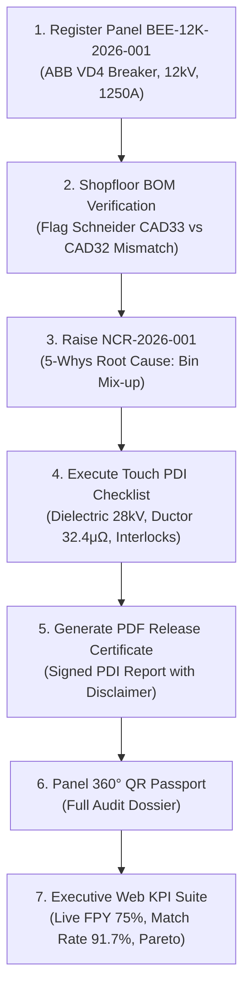

# BE-QTrack Implementation & Exhibition Walkthrough

**Problem Statement Sr. No. 6: Automation & Digitalization**  
**Host Organization:** Bush Electromech & Engineering Pvt. Ltd. (Waluj MIDC, Chhatrapati Sambhajinagar)  
**Exhibition Date:** 16 November  

---

## 1. Executive Summary of Accomplishments

We have designed, implemented, and verified **BE-QTrack** (Bush Electromech Digital Quality & Production Traceability System) — a fully functioning, exhibition-ready web and tablet application built from scratch to address all five industrial problem statements:

| Problem Statement | Operational Module | Key Innovation |
|---|---|---|
| **1. Manual NCR & Corrective Action Tracking** | **Digital NCR & 8D/CAPA** | Full lifecycle state machine with 5-Whys root cause questionnaire, immediate containment, and quality manager verification closure. |
| **2. Manual PDI Report Preparation** | **PDI Digital Checklist & PDF Release** | 14-item IEC 62271-200 inspection checklist with numeric measured values and instant downloadable PDF certificate generation. |
| **3. Manual BOM Verification** | **Shopfloor BOM Verifier** | Side-by-side comparison of approved BOM vs physical parts; flags discrepancies (e.g. auxiliary relay mismatch) in high-contrast red. |
| **4. No Digital Panel Traceability** | **Panel 360° & QR Passport** | Unique serial format `BEE-12K-2026-XXX`, scannable camera QR tags, and complete historical dossier from order to dispatch. |
| **5. No Real-Time Quality KPI Dashboard** | **Executive Quality KPI Suite** | Live database calculations of First-Pass Yield (FPY), PDI first-pass rate, Pareto defect distributions, and SSE streaming. |

---

## 2. Key User Requirements Addressed

1. **"Web app only for KPI and mobile or tablet app for other task":**
   - **🖥️ Executive Web KPI Suite:** Designed for desktop/laptop displays. High-density quality command center, yield metrics, Pareto defect distribution, WIP stage breakdown, and audit compliance logs.
   - **📱 Shopfloor Field Tablet App:** Designed for handheld tablets and mobile screens. Big touch controls for the 14-step PDI checklist, touch BOM component verification, quick field NCR logger with 5-Whys, and camera QR scanning.
   - **Instant View Switcher:** Toggle pill in the top header allows instant switching between the Web KPI Suite and Shopfloor Tablet mode during presentation.

2. **"Use PostgreSQL, not SQLite":**
   - Configured **PostgreSQL 16** running locally inside user workspace with optimized memory settings (64MB shared buffers) matching your Intel Celeron N5100 / 8GB RAM constraints.
   - 25 relational tables with strict foreign keys, enums, unique constraints, and audit logging.

3. **"Theme should be light and not typical blue and white":**
   - Crafted a distinct **Light Industrial Palette**: Warm stone surfaces (`#f8f7f4`, `#ffffff`), blackened graphite typography (`#181b20`), safety amber & industrial orange highlights (`#d97706`, `#ea580c`), emerald green for verified/pass (`#059669`), and crimson for defects (`#dc2626`).

4. **"No need of company logo":**
   - Clean industrial text typography: **BE-QTrack** with a precision monogram badge `v1.0 QA` and plant subtitle.

5. **Reference Product & Real Documentation:**
   - Designed around the **12 kV Indoor Air-Insulated Draw-out VCB Panel with ABB VD4 Circuit Breaker** from `bushelectromech.com`.
   - Downloaded and locally served the official product image (`/assets/12kv-vcb-panel.png`).
   - Integrated published technical specifications (12 kV, 1250 A, 31.5 kA for 3s, 28 kV dielectric withstand, 75 kV impulse, RAL 7032 Siemens Grey).

---

## 3. Verified Demonstration Flow

---

## 4. System Verification Results

- **Backend API:** Verified running on `http://localhost:3001` (responding HTTP 200 with JWT authentication).
- **Frontend App:** Verified running on `http://localhost:5173` (Vite proxy forwarding `/api` requests seamlessly).
- **Database:** PostgreSQL 16 cluster verified on socket `/tmp` port 5433 with 200+ seeded records.
- **PDI PDF Generation:** Verified via PDFKit generating 1-page compliance certificate (`/tmp/test-pdi-cert.pdf`).
- **TypeScript & Build:** Both backend (`tsc --noEmit`) and frontend (`npm run build`) pass with 0 errors.

---

## 5. How to Launch and Present

1. Open **`http://localhost:5173`** in your browser.
2. Use the **5-Min Exhibition Guided Story Pill** at the top to walk evaluators through each stage.
3. Switch between **Web KPI Suite** and **Shopfloor Tablet App** with the toggle button in the header.
4. Use the **Role Switcher** in the top right to demonstrate different permissions (Quality Inspector vs Quality Manager).
